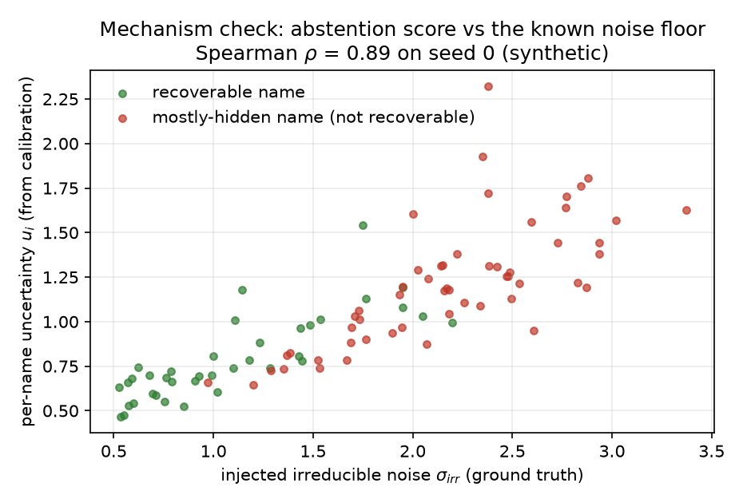
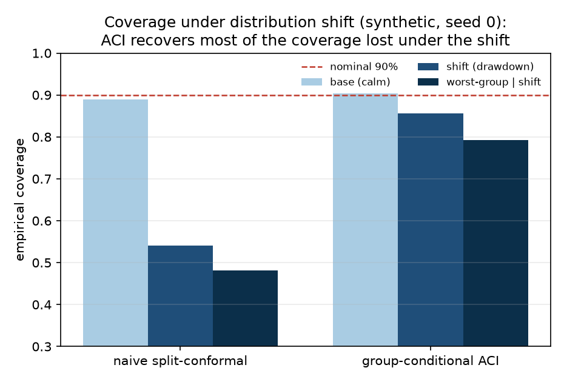
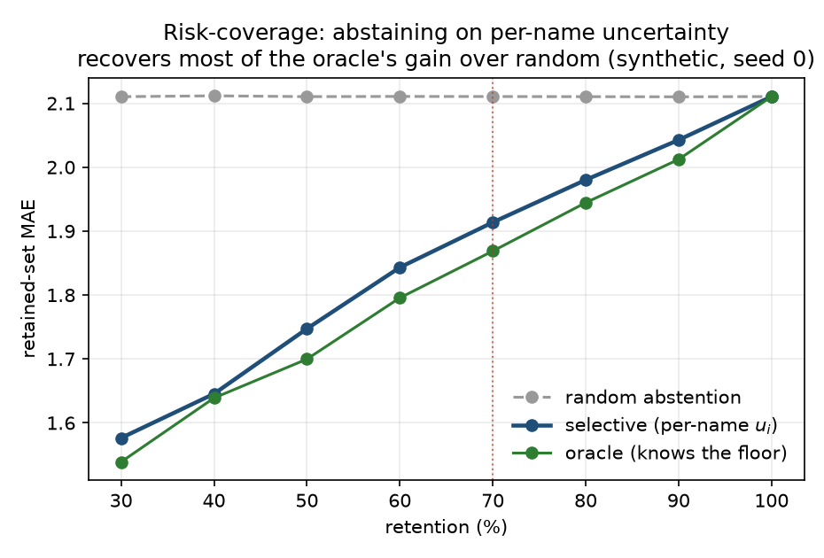

# conformal-selective-uq

[](https://github.com/niles-liu/conformal-selective-uq/actions/workflows/ci.yml)

A pre-registered study of selective conformal regression under distribution shift, on a testbed
where each stock's unrecoverable noise is known. The abstention score finds the noisy stocks
(AUC 0.81). Online conformal recovers most of the coverage a regime shift destroys (worst-group
coverage 0.51 to 0.82, target 0.90). Every check is reported exactly as it was frozen before the
run, including the two that missed.

Runs on a laptop with no API key: the headline experiment takes about 4 minutes from a fresh clone,
a toy-data quickstart about 3 seconds, and `python reproduce.py` checks every printed number against
the recorded output. The method installs as a small package with tests and CI.

| Abstention against the known noise | Coverage under the shift |
|:--:|:--:|
|  |  |
| Each dot is a stock. Its abstention score, computed from calibration data only, rises with the noise the generator injected and the model never sees. Seed 0 shown (ρ 0.89); over three seeds AUC 0.81, ρ 0.86. | Static split conformal falls to 0.48 worst-group coverage under the shift; group-conditional online conformal (ACI) reaches 0.79. Seed 0 shown; over three seeds 0.51 and 0.82, target 0.90. |

## The idea

Selective prediction lets a model abstain where it is unsure, and conformal prediction puts a
calibrated interval on what it keeps. On real data neither can show that the model abstains in the
right place, because nobody knows which points were ever predictable. So this repo builds a task
where that is known.

The demonstration task is a semi-synthetic portfolio-allocation problem on public US equity data.
Each stock's weight mixes a part the public features can recover with a hidden component the model
never sees, so the unrecoverable share is known for every stock. The hidden share is a parameter of
the generator, not a claim about any real task.

The model trains on data before 2021, calibrates on calm 2021 data, and is tested on 2022 to 2024.
On the synthetic layer, 2022 carries a deliberately severe shift. A second layer predicts real
21-day forward returns, through the real 2022 drawdown, as an external check.

## Results

The headline experiment (P2): three seeds, target coverage 90%, each check as frozen in
[its pre-registration](reports/p2_method_preregistration.md).

| Check | Rule, frozen before the run | Result | Verdict |
|---|---|---|---|
| Useful abstention | At 70% retention, error on the kept stocks beats random abstention by at least 0.119 | 0.178 better, about 75% of what an oracle that knows the noise achieves | Pass |
| Abstention in the right place | The abstention score ranks stocks by their known noise: AUC at least 0.70, Spearman ρ at least 0.40 | AUC 0.81, ρ 0.86, and it survives a control for volatility | Pass |
| Leakage guard | Shuffled labels erase the advantage | 0.178 drops to 0.002 | Pass |
| Coverage under the shift | Worst-group coverage within 7 points of 90%, and at least 0.704 | 0.815 with online conformal (ACI), against 0.507 for static split conformal | Fail: clears the floor, misses the band by 1.5 points |
| Group coverage | On the kept stocks, every group within 5 points of 90% | Size and momentum groups within; sector off by 6.0 points | Fail, by 1 point |

On the real-returns layer, online conformal lifts worst-group coverage through the 2022 drawdown
from 0.734 (static) to 0.858, which passes the same pre-registered shift rule.



Abstaining on the per-stock score recovers most of what an oracle that knows the noise gains over
random abstention (seed 0 shown).

Further along the same line:

- **More group structure.** A union over three grouping axes (sector, size, momentum) lifts
  worst-group coverage under the shift to 0.881 at 12% more width, but it over-covers, so the
  two-sided group check now fails from above (P2.1). A coupled conditional threshold is calibrated
  two-sided over the full calm period at 32% less width than the union, but misses on sector for
  the kept stocks and is not robust to the shift (P2.2).
- **Risk instead of coverage.** Online select-then-calibrate conformal risk control holds the kept
  stocks' capped miss-magnitude at the 0.08 target through the drawdown, where a static radius
  reaches 0.184 (P9). It passes its pre-registered rule at 0.0798, right on the threshold.
- **Regimes that recur.** A second synthetic layer swaps the single shift for a three-state regime
  (calm, normal, stress) whose spells last about 28 sessions. A learned regime axis (a Statistical Jump Model on
  yesterday's cross-sectional dispersion, labelled causally) adds nothing to the conservative union,
  which widens for stress on its own: +0.007, and a shuffled axis does as well (P12, a pre-registered
  miss). On the tighter calibrated threshold it does help, and a confirm on three fresh seeds passes
  all six of its gates: worst-regime coverage +0.055, matching a true-regime oracle (P12b). That lift
  is noisy per seed (-0.022 to +0.150); a parameter-free online version lifts on every seed (+0.037)
  and comes within 0.008 of the version with a hand-set step size.
- **The kept-set caveat, tested.** P2 fits the abstention score and the conformal radius on the same
  fold, so its coverage on the kept stocks has no guarantee, and on the calm test rows it over-covers
  them (0.928).
  Scoring stocks on cross-fitted training residuals instead, then calibrating on the kept stocks
  only, gives 0.896 at 12% less width, and the score finds the noisy stocks slightly better (AUC
  0.845). It passes its pre-registered checks on the three-seed mean but is noisy per seed (0.869 to
  0.927); the online version on the same kept set holds 0.901 to 0.904 on every seed (P13).

## What didn't work, and what it taught

- **The severe synthetic shift has a floor no single-shape variant clears.** Three follow-ups adapt
  one fitted conditional shape online and per group, first in interval-width space (P2.3), then in
  quantile-level space (P6, P7). Each fixes what it targeted: P6 brings calm-period coverage back
  from 0.966 to 0.900 at 26% less width than the union. None clears the 0.704 worst-group floor on
  the synthetic shift. On the milder real shift they do.
- **Abstention and group coverage interact.** The abstention layer drops more stocks from some
  sectors than from others, so coverage on the kept stocks is a harder target than the one the
  conformal layer calibrates for. That is the sector miss in the table.
- **A joint region on the simplex works in calm data and breaks under the shift.** Treating the
  whole allocation as one point on the simplex gives 0.923 joint coverage in the calm period, where
  independent per-stock intervals give 0.000. Under the shift the joint region also falls to 0.000
  (P8). Its per-stock difficulty score tracks the known noise (ρ 0.967), but that score is realized
  test error, so it shows that noisier stocks are harder to predict, not that anything abstains.
- **Two extensions added little.** A continuous kernel-localized comparator passes its checks but is
  only 0.7% tighter than discrete groups, which already capture most of the structure (P10). An
  anytime-valid e-value monitor flags the coverage break within about two weeks on every seed, but it
  also fires on the robust method and once on calm data, so it fails its pre-registered detection and
  false-alarm checks (P11).
- **One-shot calibration is noisy where online calibration is not.** Twice, a static calibrated fit
  is right on average over seeds but swings from seed to seed (P12b's calibrated threshold, P13's
  kept-set radius), while the online form of the same idea is stable on every seed.

## Use the method

The method is a small package, `selective_conformal`:

```
pip install -e .
```

[`examples/quickstart.py`](examples/quickstart.py) runs in about 3 seconds on toy data, with no
network: 30 units with their own noise levels, a noise jump partway through the test period, then
split conformal (`cqr`), online group-conditional conformal (`aci_cqr`), and abstention on a
per-unit score (`name_uncertainty`, `selective_scores`).

```
$ python examples/quickstart.py
static CQR: coverage 0.91 before the shift, 0.69 after (worst tier 0.45; target 0.90)
online ACI: coverage 0.88 before the shift, 0.81 after (worst tier 0.79; target 0.90)
abstaining on the 30% least predictable rows: MAE 2.36 -> 1.89
```

Each method fits LightGBM quantile models by default. To use your own model, pass any object with
`fit_mean(X, y)` and `fit_quantile(X, y, level)` as `learner=`, or skip fitting entirely and hand
the conformal step the quantile bands your model already produced:

```python
from selective_conformal import aci_from_quantiles

# lo_*/hi_*: your model's 5% and 95% quantile predictions; g_*: group labels; t_te: time step
lo, hi = aci_from_quantiles(lo_cal, hi_cal, y_cal, g_cal, lo_te, hi_te, y_te, t_te, g_te)
```

`cqr_from_quantiles` and `mondrian_from_quantiles` do the same for static split and group-wise
calibration. With the default model's bands they reproduce `cqr`, `mondrian_cqr` and `aci_cqr`
exactly, which the tests check.

## Reproduce

Python 3.10 or later. CI runs the tests on 3.10, 3.12 and 3.13; the published numbers were produced
on 3.12 with the versions in `requirements-lock.txt`.

```
pip install -r requirements-lock.txt && pip install -e . --no-deps   # exact tested versions
# or: pip install -e ".[experiments]"                                  # latest compatible versions
python reproduce.py               # data, P1, P2 and the figures, about 4 minutes
python reproduce.py --all         # every experiment, about 2.5 hours (--jobs 3: about 1 hour)
```

`reproduce.py` runs each driver in [`experiments/`](experiments/) and compares what it prints with
the output recorded for this release in `experiments/expected_output/`, so it answers "matches" or
"differs" per experiment; logs and any differences go to `build/reproduce/`. Each driver also runs on
its own, e.g. `python experiments/run_p2.py`. Checked from a fresh clone with freshly downloaded data
on 12 October 2026: all 30 driver runs match, in 61 minutes with `--jobs 3`.

LightGBM runs in its deterministic mode with a fixed histogram method, and no seed is set, so its
sampling seeds keep their fixed defaults. Every recorded output is the same with the deterministic
settings off, at 4 threads or on all cores.

The data is public daily prices from Yahoo (via yfinance), downloaded fresh, since Yahoo's terms
don't allow committing it. The window is pinned (2018 to 2024), and `experiments/manifest.py` checks
each built table against fingerprints of the data behind the published results, so a revised history
shows up as a named difference rather than as unexplained numbers. One such revision is known:
between the June and October 2026 downloads Yahoo changed Honeywell's prices by about one part in
ten million, and every printed number still matched. `panel.py` stops and names any ticker that
fails to download (`--allow-missing` carries on without it).

On Windows without long-path support, keep the virtual environment's path short: scikit-learn's
deepest file sits about 110 characters below it, against a 260-character limit.

## Research log

Each phase froze its decision rule in a pre-registration before it ran, then recorded what happened in
a results file. Results files that needed fixing carry a dated "Corrections (Oct 2026)" block at the
top, with the original text left as it was.

| Phase | Question | Verdict, as pre-registered | Files |
|---|---|---|---|
| P1 | Does plain conformal hold under the shift, and does interval width find the noisy stocks? | Baseline read, no gate: coverage is nominal in calm data (0.902) and collapses under the shift (worst group 0.507); width-based abstention does no better than random | [pre-reg](reports/p1_baselines_preregistration.md), [results](reports/p1_baselines_results.md) |
| P2 | Selective conformal with an abstention score and online group-conditional calibration | 3 of 5 checks pass (table above) | [pre-reg](reports/p2_method_preregistration.md), [results](reports/p2_method_results.md) |
| P2.1 | Does a union over three grouping axes fix group coverage? | Rule not met: no group under-covers, but it over-covers and widens 12% | [pre-reg](reports/p21_multiaxis_preregistration.md), [results](reports/p21_multiaxis_results.md) |
| P2.2 | Can a calibrated, not conservative, multi-group threshold fix it? | Rule not met: tightest method, misses on sector for the kept stocks, not shift-robust | [pre-reg](reports/p22_conditional_preregistration.md), [results](reports/p22_conditional_results.md) |
| P2.3 | Does per-group online correction beat a global one? | Rule not met: it beats the global one (worst group 0.599 to 0.651) but misses the floor and over-covers calm data | [pre-reg](reports/p23_adaptive_preregistration.md), [results](reports/p23_adaptive_results.md) |
| P3 | Confirmation on non-public data | Not part of this release | |
| P4, P5 | Methods note; longer archival note | Writeups | [p4](reports/p4_writeup.md), [p5](reports/p5_archival_note.md) |
| P6 | Quantile-level adaptation on the single conditional shape | Rule not met: calm coverage back to nominal at lower width; worst-group floor still missed | [pre-reg](reports/p6_alphaspace_preregistration.md), [results](reports/p6_alphaspace_results.md) |
| P7 | Combine grouping axes by the most conservative one | Rule not met: fixes a cross-axis cancellation; +0.004 worst-group on the synthetic, +0.037 on real returns | [pre-reg](reports/p7_levelcomb_preregistration.md), [results](reports/p7_levelcomb_results.md) |
| P8 | One joint region for the whole allocation, on the simplex | Rule not met: joint coverage 0.923 against 0.000 in calm data, 0.000 under the shift | [pre-reg](reports/p8_simplex_preregistration.md), [results](reports/p8_simplex_results.md) |
| P9 | Selective conformal risk control for regression | Passes: online risk 0.080 against static 0.184 under the shift; the efficiency claim is a null | [pre-reg](reports/p9_riskcontrol_preregistration.md), [results](reports/p9_riskcontrol_results.md) |
| P10 | Does continuous kernel localization beat discrete groups? | Passes, but only 0.7% tighter: discrete groups suffice | [pre-reg](reports/p10_localized_preregistration.md), [results](reports/p10_localized_results.md) |
| P11 | Can an e-value monitor flag the coverage break? | Detection and false-alarm checks fail as frozen; it does flag the break early on every seed | [pre-reg](reports/p11_evalue_preregistration.md), [results](reports/p11_evalue_results.md) |
| P12 | Does a learned regime axis help group-conditional conformal when regimes recur? | Rule not met: the union absorbs the regime on its own (+0.007; a shuffled axis matches it). Post hoc, on the calibrated threshold, the learned axis lifts worst-regime coverage +0.068, equal to a true-regime oracle | [pre-reg](reports/p12_regime_axis_preregistration.md), [results](reports/p12_regime_axis_results.md) |
| P12b | Pre-registered confirm of that post-hoc result on three fresh seeds | Passes, 6 of 6 gates on the mean: +0.055 on the calibrated threshold, noisy per seed; the parameter-free online version lifts on every seed | [pre-reg](reports/p12b_calibrated_seam_preregistration.md), [results](reports/p12b_calibrated_seam_results.md) |
| P13 | Selection-aware calibration for the kept stocks | Passes on the three-seed mean: 0.896 against P2's 0.928, 12% narrower; noisy per seed, while the online version is nominal on every seed | [pre-reg](reports/p13_selection_aware_preregistration.md), [results](reports/p13_selection_aware_results.md) |

## Limits

- The synthetic layer shows how the method behaves when the noise floor is known. It says nothing
  about how large that floor is in any real task; the real-returns layer is the external check.
- P2's coverage on the kept stocks is empirical. P13's selection-aware version is finite-sample valid
  under exchangeability, and nominal on average over seeds but not on every seed.
- Two verdicts sit on their thresholds: P9's shift-risk check (0.0798 against 0.08) and P11's
  calm-period false alarm (e = 20.02 against 20). Tiny numerical drift could flip either one.
- Some pre-registrations refer to a confirmation run on non-public data, or to documents and notes
  kept with it; none of that is part of this release, and those passages are replaced by a marked
  redaction. In October 2026 the frozen files were otherwise changed only by those redactions, a few
  marked term edits, and the dated Corrections blocks. P13 was written in October 2026 and committed
  before it ran.
- [`SPEC.md`](SPEC.md) is the June 2026 design document. Results differ from it in places; the
  README and `reports/` record what was found.

## Layout

| Path | What |
|---|---|
| `src/selective_conformal/` | The package: the conformal methods (`conformal.py`), learners, abstention score (`selective.py`), metrics, and the extensions (`simplex.py`, `riskcontrol.py`, `evalue_monitor.py`, `regime.py`, `pogo.py`) |
| `experiments/` | The data pipeline (`panel.py`, `synthetic.py`, `synthetic_regime.py`), the data manifest, one `run_*.py` driver per phase, `figures.py`, and the recorded outputs |
| `tests/` | pytest suite: no network, under a minute |
| `examples/` | The toy-data quickstart |
| `reports/` | A pre-registration and a results file per phase, plus the two notes |
| `figures/` | The committed figures |
| `reproduce.py` | One command to rerun and check the published results |
| `data/` | Gitignored; built locally by `panel.py` and the drivers |

The frozen reports refer to the drivers by their v0.2.0 paths (`src/run_p2.py`); since v0.3.0 they
live in `experiments/`.

## Citation and license

To cite this work, see [`CITATION.cff`](CITATION.cff). MIT license, see [`LICENSE`](LICENSE).
